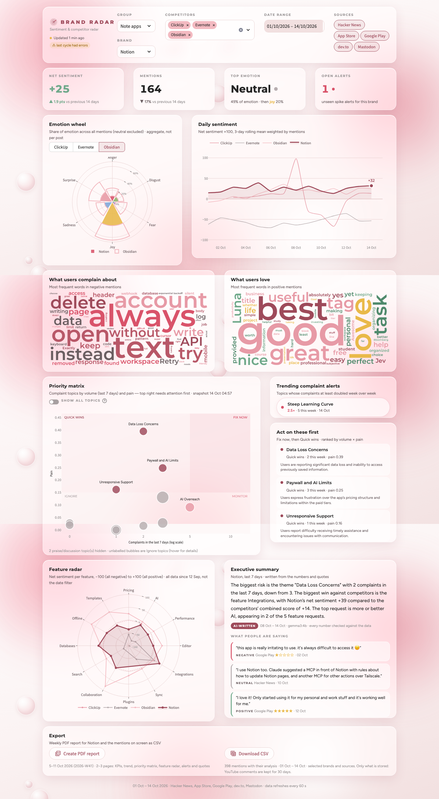
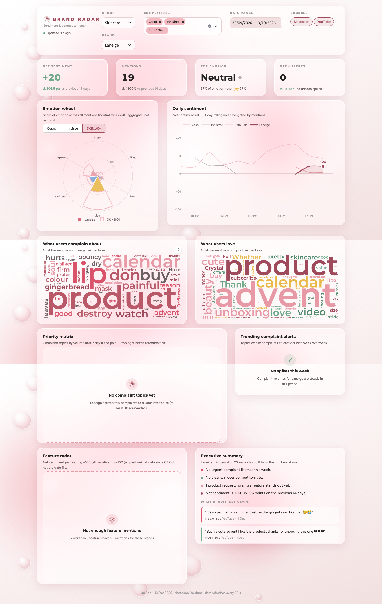

# Brand Radar

**Brand sentiment and competitor radar.** Brand Radar collects public chatter about a product and its
competitors from Hacker News, the App Store, Google Play, YouTube, news (GDELT), Mastodon and dev.to (Reddit
optional). It analyses that chatter with local
transformer models (sentiment, emotion, category, feature) and clusters the complaints into topics.
Each topic gets a priority score, and the results appear on a live Streamlit dashboard in a
"Blush glass" design. Everything is stored in MySQL (MariaDB in XAMPP).

It works for any industry. Out of the box it tracks three brand groups, each with one own brand and its competitors:
**Note apps** (Notion vs Obsidian, Evernote, ClickUp), **Skincare** (Laneige vs SKIN1004, Cosrx, Innisfree) and
**Stationery** (DOMS vs Apsara, Nataraj, Camlin). Brands are configured in `brands.yaml`.


## Features

- **Any industry**: industry profiles (`profiles.yaml`) for software, skincare, stationery, food & beverage,
  fashion and consumer products. Each profile has its own complaint categories, praise labels and default sources.
  A brand with its own app (store ids in `brands.yaml`) also gets an *app and ordering experience* complaint
  category (app crashes, login, ordering, payment, delivery tracking); software profiles already cover that.
  Brands are organised in groups, and the dashboard switches between them.
- **Collector** (`collector.py`): every 6 hours it fetches new mentions, analyses them, re-clusters
  topics and recomputes priorities. NLP models are only loaded when there is something new.
- **Local NLP**: sentiment, emotion, zero-shot category and keyword-gated feature detection. It runs on
  Apple Silicon (MPS) or CPU, with no API keys or paid services. Each mention's language is detected;
  only English is analysed, and the other mentions are counted per brand.
- **Complaint topics** with BERTopic, readable labels and manual overrides (`topic_labels.yaml`).
- **Priority matrix**: complaint volume vs pain, in four quadrants (Fix now, Quick wins, Monitor, Ignore).
- **Spike alerts** when a topic's complaints at least double week over week.
- **Dashboard**:
  - KPI cards and an emotion wheel
  - sentiment trend
  - complaint and praise word clouds
  - priority matrix and feature radar vs competitors
  - alert pills
  - a 20-second executive summary built from the numbers, with representative quotes

  The KPIs, alerts and "Updated … ago" status refresh every 60 s without reloading the page.
- **Weekly PDF report** per brand (2–3 pages in the Blush glass style), **CSV export** of the filtered
  mentions, both downloadable from the dashboard.
- **Notifications** (optional): new spike alerts by email and/or Slack after each collector cycle, and the
  weekly PDF every Monday morning.
- **AI insights** (optional, Step 10): a local LLM (Ollama, `gemma3:4b`) or Claude Haiku writes topic labels
  with a one-line description, a weekly briefing per brand checked against the numbers, and English
  translations of Hindi, Bengali, Hinglish, Vietnamese and other mentions so they get analysed too. It
  falls back to the rule-based labels and summary per item, and the dashboard never calls the LLM.
- **Track any brand from the dashboard** (Step 11): type a name (McDonald's, Nivea, Tesla…) and the
  collector researches its industry, competitors and ambiguous meanings, shows a dry-run preview to approve,
  edit or cancel, then fetches and analyses the new group. Groups added this way can be removed again.
- **Demo mode** with a separate, fictional dataset, so the dashboard can be shown without real data.

## Tech stack

| Area | Tools |
|---|---|
| Language | Python 3.11 |
| Storage | MySQL / MariaDB (XAMPP), SQLAlchemy 2, PyMySQL |
| Sources | Algolia HN Search + Firebase, iTunes RSS reviews feed, `google-play-scraper`, YouTube Data API v3 (optional key), GDELT DOC 2.0, Mastodon and dev.to public APIs, optional PRAW (Reddit) |
| Language | `lingua-language-detector`, a script check and a Hinglish word list |
| NLP | PyTorch, Hugging Face Transformers, sentence-transformers, BERTopic (UMAP + HDBSCAN) |
| Scheduling | APScheduler |
| Dashboard | Streamlit, Plotly, `wordcloud` |
| AI insights (optional) | Ollama (`gemma3:4b`, local, JSON-schema output) or the Anthropic SDK (Claude Haiku) |
| Reports | ReportLab (PDF, fonts embedded), kaleido 1.x (Plotly charts drawn by the installed Google Chrome), `smtplib`, Slack incoming webhooks |
| Tests | pytest with mocked HTTP and models (no downloads), Streamlit AppTest, Playwright screenshots |

## How it works

```
 Sources                    Collector  (every 6 h, one cycle at a time)            MySQL                 Dashboard
 ───────                    ───────────────────────────────────────────            ─────                 ─────────
 Hacker News  ──┐   1 fetch      new mentions since the last success, deduped ──►  mentions, fetch_runs
 App Store    ──┤
 Google Play  ──┼─► 2 NLP*       sentiment · emotion · category · feature    ──►  analysis              Streamlit
 Mastodon     ──┤   3 translate  non-English -> English (optional LLM)       ──►  mentions.text_en
 dev.to       ──┤   4 topics*    BERTopic per brand on complaints**          ──►  topics, topic_daily ──► reads only,
 YouTube      ──┤   5 priority   volume × pain, quadrants, spike alerts      ──►  topics, alerts        cached 60 s
 News (GDELT) ──┤   6 insights   LLM labels + briefings (optional)           ──►  topics, briefings
 Reddit (opt) ──┤                cycle record, LLM timings                   ──►  collector_runs, llm_runs
 CSV import   ──┘
                    * runs in a short-lived child process, so the models' memory is freed after each cycle
                    ** dev.to and news are left out of complaint topics, the matrix and alerts (TOPIC_EXCLUDED_SOURCES)
```

The collector and the dashboard are separate processes. The dashboard only reads MySQL; it never calls an
external API or loads a model, so it stays fast and light. Its one write is the "Track a new brand" card,
which only adds and updates rows in `brand_requests`; the collector checks that table every 30 seconds.

## Setup

Works on macOS and Windows (Linux too). You need **Python 3.11** and **XAMPP**.

> **Note:** the Windows steps below haven't been tested on a Windows machine yet; Brand Radar was built and tested on macOS.

**1. Install XAMPP** from [apachefriends.org](https://www.apachefriends.org) and start **MySQL** in the
XAMPP Control Panel. XAMPP's MySQL client is here (its `root` user has no password by default):

| macOS | Windows |
|---|---|
| `/Applications/XAMPP/xamppfiles/bin/mysql` | `C:\xampp\mysql\bin\mysql.exe` |

**2. Get the code and create a Python environment**

```bash
git clone <this repository> BrandRadar
cd BrandRadar
```

| macOS / Linux | Windows (PowerShell) |
|---|---|
| `python3.11 -m venv venv` | `py -3.11 -m venv venv` |
| `source venv/bin/activate` | `venv\Scripts\Activate.ps1` |
| `pip install -r requirements.txt` | `pip install -r requirements.txt` |

**3. Create the database and a dedicated user.** Run these from the project folder with XAMPP's client
(replace `mysql` with the full path above if it is not on your PATH, and choose your own password).
`source` works the same in Terminal, PowerShell and cmd:

```bash
mysql -u root -e "source db/schema.sql"
mysql -u root -e "CREATE USER 'radar'@'localhost' IDENTIFIED BY 'choose-a-password'; CREATE USER 'radar'@'127.0.0.1' IDENTIFIED BY 'choose-a-password'; GRANT ALL PRIVILEGES ON brand_radar.* TO 'radar'@'localhost', 'radar'@'127.0.0.1'; GRANT ALL PRIVILEGES ON brand_radar_demo.* TO 'radar'@'localhost', 'radar'@'127.0.0.1';"
```

**4. Configuration:** copy `.env.example` to `.env` (`cp` on macOS, `copy` on Windows) and set
`DB_PASSWORD` to the password you chose. Every setting (intervals, thresholds, sources) lives in `.env`;
secrets never go in code, and `.env` is git-ignored.

**5. Brands, models, first data**

```bash
python manage_brands.py            # brands.yaml -> brands table
python -m nlp.pipeline --download  # ~2.5 GB of models into the Hugging Face cache (once)
python collector.py --once         # first fetch + analysis
python check_setup.py              # checks Python, packages, models, database, collector, demo data
```

The first analysis takes about 15 minutes on an 8 GB Apple Silicon Mac (GPU via MPS). On Windows the models
run on the CPU (or an NVIDIA GPU if PyTorch sees one), so expect it to take longer.

## Running it

| What | macOS / Linux | Windows (PowerShell) |
|---|---|---|
| Collector + dashboard together (Ctrl+C stops both) | `scripts/start.sh` | run the next two lines in two terminals |
| Collector, every `COLLECTOR_INTERVAL_HOURS` (default 6) | `python collector.py` | `python collector.py` |
| Dashboard | `streamlit run app.py` | `streamlit run app.py` |
| One collector cycle | `python collector.py --once` | `python collector.py --once` |
| Build the demo database | `python seed_demo.py` | `python seed_demo.py` |
| Work through "Track a new brand" requests now | `python collector.py --requests-once` | same |
| Dashboard on demo data | `BRAND_RADAR_DEMO=1 streamlit run app.py` | `$env:BRAND_RADAR_DEMO=1; streamlit run app.py` |
| Import a CSV (`source, author, text, date, rating`) | `python fetch.py --csv file.csv --brand Notion` | same |
| Add a brand interactively | `python manage_brands.py add` | same |
| Test a brand's matching (nothing stored) | `python manage_brands.py dry-run --brand Nataraj` | same |
| Weekly PDF report (last complete week) | `python -m reports.weekly [--brand X \| --group G] [--week 2026-W41]` | same |
| Send a test notification | `python -m reports.notify --test` | same |
| Tests | `python -m pytest -q` | same |

The dashboard opens at <http://localhost:8501>. In PowerShell, `$env:BRAND_RADAR_DEMO` stays set for that
terminal; close it (or run `Remove-Item Env:BRAND_RADAR_DEMO`) before going back to real data.

Only one collector runs at a time (a lock file plus APScheduler `max_instances=1`); a second one exits
with a message. If a stage fails, the error is logged to `collector_runs` and the later stages still run.

**Demo mode** reads a separate `brand_radar_demo` database with about 3,000 fictional mentions over 60
days for all three groups, built from templates (no real people). Each group uses its profile's
categories, features and sources, and has complaint topics in every priority quadrant plus spike alerts. Your real data is never touched: the seed script refuses to
write to `DB_NAME`, and the collector refuses to run in demo mode. Re-running `seed_demo.py` rebuilds it.

## Exports and weekly report

**Weekly PDF** (`reports/weekly.py`): one report per brand and ISO week (Monday–Sunday), 2–3 A4 pages in the
Blush glass palette, with Montserrat and Figtree embedded:

1. **Overview:** KPIs with week-over-week change, the executive summary, daily sentiment against the
   competitors in the same group, and complaints per category from the brand's industry profile.
2. **Priorities:** the priority matrix, the top Fix now and Quick wins topics (with a quote each), and
   the week's spike alerts.
3. **Competitors and voices:** the feature radar against the group's competitors, and one negative,
   one neutral and one positive quote.

Sections with too little data (common for Skincare and Stationery for now) show a short "not enough data
yet" note instead of an empty chart. The PDF uses the same queries, maths and Plotly figures as the
dashboard. Charts are drawn by your installed Google Chrome through kaleido; nothing is sent anywhere.
Files go to `reports/output/brandradar-<brand>-<week>.pdf` (git-ignored). In demo mode every page carries
a "Demo data" mark.

```bash
python -m reports.weekly                        # the own brand of every group, last complete week
python -m reports.weekly --group Skincare --week 2026-W41
BRAND_RADAR_DEMO=1 python -m reports.weekly --brand DOMS
```

**From the dashboard:** the Export card at the bottom builds the PDF for the selected brand on click, for the
last full week up to the end of the date filter. It also downloads the mentions on screen as CSV (brands,
dates and sources from the filters, with sentiment, emotion, category, feature and topic). The CSV only
contains what is stored, so YouTube comments are at most 30 days old, as YouTube's policies require. Author
handles are left out, and cells that start with `=`, `+`, `-` or `@` are escaped so spreadsheet apps don't
run them as formulas.

## Notifications

Optional, and off until you add settings to `.env`. With email and/or Slack set up:

- after each collector cycle, **new spike alerts** are sent in one message (brand, topic, profile category,
  this week vs last week, a quote). Only alerts from the last 7 days are sent, so turning notifications on
  doesn't deliver old history;
- every **Monday at 08:00 Asia/Kolkata** (`NOTIFY_TIMEZONE`, `NOTIFY_WEEKLY_HOUR`), the weekly report for
  each group's own brand (`NOTIFY_WEEKLY_BRANDS`) is emailed with the PDFs attached. Slack incoming
  webhooks can't carry files, so Slack gets a short summary instead. If the collector was off at 08:00,
  the next cycle within 24 hours sends it.

Every alert and weekly report goes out **at most once per channel**: it is recorded in the `notifications`
table before sending, and a failed send is retried in the next cycles (up to 3 attempts). Demo mode never
sends. Check your settings with `python -m reports.notify --test`, which sends one test message to each
configured channel. `python check_setup.py` shows what is configured and what has been sent.

**Email with a Gmail app password**

1. Turn on **2-Step Verification** for the Google account you want to send from
   ([myaccount.google.com/security](https://myaccount.google.com/security)). App passwords only exist
   with 2-Step Verification on, and work or school accounts may have them disabled by their admin.
2. Open [myaccount.google.com/apppasswords](https://myaccount.google.com/apppasswords), name it
   "Brand Radar" and copy the 16-character password. Google shows it only once.
3. In `.env`:

   ```ini
   SMTP_HOST=smtp.gmail.com
   SMTP_PORT=587
   SMTP_USER=you@gmail.com
   SMTP_PASSWORD=abcd efgh ijkl mnop   # the app password (spaces are ignored), never your normal password
   NOTIFY_EMAIL_TO=you@gmail.com,teammate@example.com
   ```

Any other SMTP server works the same way (port 587 uses STARTTLS, port 465 uses TLS from the start).

**Slack incoming webhook**

1. Go to [api.slack.com/apps](https://api.slack.com/apps), choose **Create New App → From scratch**, name it
   "Brand Radar" and pick your workspace.
2. Under **Incoming Webhooks**, switch **Activate Incoming Webhooks** on, click **Add New Webhook to
   Workspace** and choose the channel.
3. Copy the webhook URL (`https://hooks.slack.com/services/…`) into `.env` as `SLACK_WEBHOOK_URL=…`. Treat
   it like a password: anyone with it can post to that channel. Brand Radar never logs it.

Restart the collector after changing `.env`.

## AI insights (optional)

Off by default (`LLM_PROVIDER=none`): the dashboard then shows the keyword topic labels and the rule-based
executive summary, exactly as before. With an LLM switched on, the collector adds two stages after the NLP
models have exited, so the LLM never shares memory with them:

| Stage | What it writes | When it regenerates |
|---|---|---|
| **translate** (after NLP) | `mentions.text_en`: English for non-English and Hinglish mentions; the original stays in `text`. The translated text then goes through sentiment, emotion, category and topics. Adverts ("order here 👉") are flagged and left out. | Once per mention (`--redo` to re-translate) |
| **labels** (after topics) | A 2–4 word label and a one-sentence description per topic, written from 8–10 of its mentions in the industry's words. `topics.label_source` records `llm`, `keyword` or `manual`; `topic_labels.yaml` always wins. | When a topic's members changed by `LLM_LABEL_REFRESH` (20%) or more |
| **briefings** | 3–5 sentences per brand: biggest risk, biggest win against the competitors, top request, a notable change, each only when the facts have one; thin brands get volume, sentiment and quotes instead (`briefings` table). The dashboard's summary card and the weekly PDF show it with an **AI-written** tag. | `last7` when its facts change; each ISO week once |

**Grounding.** The briefing is written only from a fact sheet built by the same code as the rule-based summary
(`ui/insights.py`). Every number in it must appear in the facts with the same sign, numbers must be digits,
and it must be 3–6 plain sentences. A briefing that fails gets one retry with the reason; if that fails too,
the dashboard keeps the rule-based summary. Labels, descriptions and translations have similar checks
(word count, no brand name, no duplicate label, a translation that isn't just the original). Any failure,
timeout or unreachable LLM falls back for that item only, and the cycle carries on.

**Providers** (`.env`):

```ini
LLM_PROVIDER=ollama          # none (default) | ollama | anthropic
OLLAMA_MODEL=gemma3:4b       # brew install ollama && brew services start ollama && ollama pull gemma3:4b
ANTHROPIC_API_KEY=sk-ant-…   # only for LLM_PROVIDER=anthropic (claude-haiku-5-5)
```

`gemma3:4b` needs Ollama 0.6 or newer and about 2.8 GB while it runs. It is unloaded (`keep_alive=0`) at the
end of each stage. On the real data it translated all 12 test mentions in Bengali, Vietnamese, Hinglish, Urdu,
Chinese, Japanese and Spanish correctly; the lighter `qwen2.5:3b` garbled Bengali and mistook a complaint about ads for an advert.
Every LLM stage is logged in `llm_runs` (seconds, items, generated, cached, fallbacks; tokens and cost in
USD for Anthropic), and `python check_setup.py` shows the last runs and translated counts per brand.

```bash
python -m nlp.llm --check                         # is the provider reachable?
python -m nlp.llm --translate                     # then: python -m nlp.pipeline && python -m nlp.topics
python -m nlp.llm --labels --briefings [--brand X] [--force]
BRAND_RADAR_DEMO=1 python -m nlp.llm --labels --briefings
```



**New industries.** When `manage_brands.py add` gets a profile name that doesn't exist, the LLM drafts one
(categories, complaints, praise, requests, features, sources) and shows it for you to accept, edit or reject
before it is written to `profiles.yaml`. Without an LLM the brand uses `consumer_product`.

## Track any brand from the dashboard

The **Track a new brand** card at the bottom of the dashboard sets up a new group without the terminal.
The collector must be running (`python collector.py` or `scripts/start.sh`); it checks for requests every
`TRACK_POLL_SECONDS` (30), separately from the 6-hour cycle.

1. **Track.** Type a brand and press Track. Names already tracked (in any spelling: *McDonalds* =
   *McDonald's*) are refused, and at most `TRACK_MAX_ACTIVE` (3) requests can be in progress.
2. **Researching** (about 1–2 minutes with gemma3:4b):
   - the industry: an existing profile, or a new one drafted for review (*fast food*, *banking*, *airlines*…);
   - the market, which becomes the group name (*Body lotions*, *Burger chains*), and 3 well-known competitors;
   - for every brand: spellings, other meanings of the name and the rules that filter them out: phrases cut
     out before matching (*Tesla coil*), words that drop a post (*physicist*, *pigeon*), and for names that are
     often something else, context words a post must contain (*pizza*, *order* for Domino's). Every rule is
     checked: an exclude phrase must contain the name, a drop word must not, and words describing the
     industry's own products can never drop a post;
   - App Store and Google Play ids, looked up live and only kept when the developer is the brand and the
     LLM says it has its own app (store reviews then become sources);
   - a **dry run** of the name-matched sources over the last 30 days (nothing stored; YouTube searches
     titles only, 1 call).
3. **Waiting for your review.** The card shows the proposed industry, group, competitors and rules, the
   dry-run counts per brand and source, and 10 matched and 10 rejected texts. **Approve**, **Edit** (change
   anything, add or leave out competitors, then approve or re-check) or **Cancel** (nothing is written).
   Without an LLM, the review asks you to pick the industry profile and type the competitors; their rules
   are filled in by a re-check.
4. **Fetching → Analysing.** On approve, the collector saves a drafted profile to `profiles.yaml`, appends
   the group to `brands.yaml` (the same code as `manage_brands.py add`) and runs fetch → NLP → translate →
   topics → priority → labels and briefing for the **new group only**, one heavy step at a time (the models
   run in a child process and Ollama is unloaded after use). Each source gets at most
   `TRACK_SOURCE_SECONDS` (90 s) per brand, so a slow GDELT can't hold a request up; YouTube uses only each
   brand's first search query for this first fetch, and the 6-hour cycles fill in the rest.
5. **Ready** or **Not enough data yet.** The card shows mentions per brand and source, analysed counts and
   the top complaint topics. A brand whose own brand has fewer than `TRACK_MIN_MENTIONS` (30) analysed
   mentions ends as *Not enough data yet*: the group stays and keeps collecting, and exported reviews can be
   added with `python fetch.py --csv`. Pick the new group in the header to see its dashboard.
   Physical products often start here: YouTube is read through the brand's newest 30 videos, which for a
   brand like Nivea are mostly days-old Shorts with almost no comments yet (3 comments across 30 videos on the
   first run), and GDELT often rate-limits a burst of new queries.

**Measured on the first real run** (8 GB M2, gemma3:4b): McDonald's took about 4 minutes from Track to
review (72 s research, 164 s dry run) and 28 minutes from Approve to Ready (fetch 3.5 min, NLP on 963
mentions 10 min, translating 88 non-English mentions 9 min, topics 0.5 min, labels and briefing 5 min):
635 analysed McDonald's mentions (500 Google Play reviews, 127 YouTube comments, 22 Mastodon posts). The
group first used the plain `food_beverage` profile, which has no category for app problems, so app
complaints were spread over *delivery*, *freshness/quality* and *health/ingredients*. Brands with store ids
now also get the *app and ordering experience* category (see [above](#the-app-and-ordering-category)):
re-analysed, 186 of McDonald's 635 mentions fall in it, and 8 of its 11 topics are app topics (*App Loading
Issues*, *App Ordering Problems*, *Redemption System Failure*…) next to *Decreased Product Quality* and
*Disappointing Halloween Products*. Nivea ended as *Not enough data yet*.

**Removing a group.** *Remove a group added here* deletes a dashboard-added group's brands, mentions,
analysis, topics and alerts, and its blocks in `brands.yaml`, after you type the group's name to confirm.
Groups set up by hand in `brands.yaml` (Note apps, Skincare, Stationery) can only be removed there.
`python collector.py --requests-once` works through pending requests from the terminal.

### The app and ordering category

Brands with a store id (`app_store_id` or `play_store_id`) are classified with their industry profile **plus**
one complaint category, *app and ordering experience* ("the mobile app or online ordering, such as app
crashes, login problems, payment errors, wrong or missing items in an order, or delivery tracking"). Without
it, a restaurant's app complaints are spread over whichever product category is nearest (*delivery*,
*freshness/quality*). It is a complaint category, so a neutral "the app logged me out" counts in topics, the
matrix and the report. It applies to every profile except software and only to the brands that have an app:
competitors without store ids keep the plain industry categories. The brand's model version gets an `.app`
tag (`p4.food_beverage1.app-…`), so adding store ids to a brand makes its old rows outdated:

```bash
python -m nlp.pipeline --reanalyse --model-version outdated --brand "McDonald's"   # only that brand's rows
python -m nlp.topics --brand "McDonald's" && python -m nlp.priority
python -m nlp.llm --labels --briefings --force --brand "McDonald's"
```

## Tracking another industry

Each brand belongs to a **group** (one own brand plus competitors) and every group uses one **profile** from
`profiles.yaml`. The profile sets the zero-shot categories and which of them count as complaints (for example,
*smudging* and *breakage/durability* for stationery, *skin reaction* and *texture* for skincare), the praise and
request labels, and the sources fetched by default. Software keeps its original labels; the profiles for
food & beverage, fashion and consumer products are ready but have no brands yet.

1. Add the brands with `python manage_brands.py add`, or edit `brands.yaml` (`group`, `profile`, `keywords`,
   and for ambiguous names `require_context` and `exclude_if`).
2. Check the matching **before** storing anything: `python manage_brands.py dry-run --group Stationery`
   lists matched and rejected texts with the reason for each rejection.
3. Sync, then let the collector run (or `python fetch.py --brand X`).

Physical products get far less public chatter than apps: no store reviews and few forum threads. The first
30-day run of the Skincare and Stationery groups found 69 and 70 usable mentions, almost all YouTube comments,
so neither group reached the 30 complaints needed for topics yet. Importing marketplace reviews by CSV is the
quickest way to fill these groups. See **[docs/first-run-skincare-stationery.md](docs/first-run-skincare-stationery.md)**.



## Data sources and their limits

| Source | Notes |
|---|---|
| Hacker News | Algolia keyword search (stories and comments) plus Firebase. Free and reliable. Common words like "notion" need case-sensitive matching and exclude lists (`brands.yaml`). |
| App Store | The public reviews feed only returns **recent** reviews (up to ~500 per country); we read the US, India, the UK, Canada and Australia. |
| Google Play | `google-play-scraper` is unofficial and can break when Google changes its pages; failures are logged, not fatal. English, US store. |
| Reddit | **Optional, off by default.** Posts and top-level comments that name the brand, plus the brand's own subreddits. Needs approved API credentials; see [Enabling Reddit](#enabling-reddit). Skipped cleanly without them. |
| Mastodon | Public hashtag timelines (#notion, #obsidian…) on mastodon.social, fosstodon.org and hachyderm.io (`MASTODON_INSTANCES`), no login. English posts only; people who opted out of search or discovery, bots, boosts and non-public posts are skipped; the post must still name the brand. Full-text search needs a login, so hashtags are the open route. About 40 mentions a month, almost all Notion and Obsidian. |
| dev.to | Articles tagged with the brand plus their top-level comments, via the public Forem API (no key). Mostly makers writing about their own tools, so it feeds sentiment, the feature radar and word clouds but is **left out of complaint topics, the matrix and alerts** (`TOPIC_EXCLUDED_SOURCES`). At most 3 items per author per brand and run. |
| YouTube | **Optional, needs a free API key** (see [Enabling YouTube](#enabling-youtube)). Searches videos whose *title* names the brand (`youtube_queries` in `brands.yaml`), then reads the comments of the newest 30 per brand. Comments don't need to repeat the brand name, but ones under 3 words must (poll and giveaway answers like "Sketch book" carry no opinion). At most 3 per author. Comments are kept 30 days unless seen again, as YouTube's policies require. |
| News | GDELT article search, free and keyless. Only headlines (coverage, not customer feedback), so news counts for volume and sentiment but stays **out of complaint topics**. GDELT rate-limits busy periods (429); the run is logged and retried next cycle. |
| CSV import | Any other source (e.g. exported marketplace reviews or social posts), via `fetch.py --csv`. Header names are matched loosely (`--map` for others) and ratings like 4/5, 8/10 or ★★★★ become 1–5. |

## Enabling Reddit

The Reddit source is built and tested, but stays off until you add API credentials. Getting them is
no longer self-service:

1. **Read Reddit's rules first:** the [Responsible Builder Policy](https://support.reddithelp.com/hc/en-us/articles/42728983564564-Responsible-Builder-Policy),
   the [Reddit Data API Wiki](https://support.reddithelp.com/hc/en-us/articles/16160319875092-Reddit-Data-API-Wiki)
   and [Developer Platform & Accessing Reddit Data](https://support.reddithelp.com/hc/en-us/articles/14945211791892-Developer-Platform-Accessing-Reddit-Data).
   Since the policy took effect (November 2025) every app needs explicit approval before it can use the API.
   Using Reddit data for a business needs separate written approval.
2. **Request access** with Reddit's [developer support form](https://support.reddithelp.com/hc/en-us/requests/new?ticket_form_id=21879292693140).
   Describe Brand Radar honestly: read-only, low volume (a few hundred requests every 6 hours), public posts
   and comments about specific products, analysed locally, never redistributed. Reddit asks developers to use
   its Developer Platform (Devvit) where possible; this form is for tools Devvit can't support, such as this
   external analysis. Approval is not guaranteed, and replies can take a while.
3. **Mind the deadlines** (as reported by the press, e.g.
   [TechRepublic](https://www.techrepublic.com/article/news-reddit-rss-public-api-shutdown/) and
   [Decrypt](https://decrypt.co/379892/reddit-killing-rss-feeds-public-api-access-ai-scrapers)):
   Reddit stops accepting new public API requests on **31 October 2026**, and remaining public Data API
   access is due to end in **March 2027**. After that, this source will stop working even with credentials.
4. **Once approved**, fill in these values in `.env` and restart the collector:

   ```ini
   REDDIT_CLIENT_ID=your-client-id
   REDDIT_CLIENT_SECRET=your-client-secret
   REDDIT_USER_AGENT=python:brand-radar:0.1 (by u/your-reddit-username)
   ```

   `python check_setup.py` then shows Reddit as configured, and the next collector cycle fetches it. Which
   subreddits count as a brand's own is set by `subreddits` in `brands.yaml`
   (`Notion`, `ObsidianMD`, `Evernote`, `clickup`).

## Enabling YouTube

YouTube is the main source for the Skincare and Stationery groups. The key is free:

1. In the [Google Cloud Console](https://console.cloud.google.com/) create a project, open **APIs & Services →
   Library** and enable **YouTube Data API v3**.
2. Under **APIs & Services → Credentials**, choose **Create credentials → API key**, then restrict the key
   to the YouTube Data API v3.
3. Put it in `.env` as `YOUTUBE_API_KEY=...` and restart the collector. `python check_setup.py` shows the
   quota used today.

The free quota is 10,000 units a day, plus a separate cap of 100 search calls a day. Brand Radar stops
at `YOUTUBE_SEARCH_BUDGET` (80) and `YOUTUBE_UNIT_BUDGET` (8,000), so a busy day never hits Google's limits.
The key travels in a request header, never in a URL, so it can't leak into logs.

## Model quality (measured on the real data)

| Check | Result |
|---|---|
| Sentiment vs star rating, App Store | **79.2%** agree (87.9% leaving out 3★ reviews) |
| Sentiment vs star rating, Google Play | **76.5%** agree (81.3% leaving out 3★ reviews) |
| Mentions with a detected feature | 27–48% per brand (keyword gate + zero-shot confirmation) |
| Topic ids across re-runs | stable (same data -> same ids; new data joins existing topics) |
| Collector cycle, nothing new | ~1 min, no models loaded; idle collector ~55 MB |
| First full analysis, 816 mentions | ~13 min on an 8 GB M2 (MPS) |

Models: `cardiffnlp/twitter-roberta-base-sentiment-latest`, `j-hartmann/emotion-english-distilroberta-base`,
`facebook/bart-large-mnli` (zero-shot) and `sentence-transformers/all-MiniLM-L6-v2` (topics).

## Known limitations

- **English analysis.** Without an LLM, non-English mentions are stored without labels (counted per brand
  in `check_setup.py`); with one, they are translated first (at most `LLM_MAX_TRANSLATIONS`, 80, per cycle).
  A 4B model still slips now and then (Bengali "oily face" came out as "Wave Face", "Cosrx" as "Cozera X"),
  and very short romanised Hindi or Bengali is rejected as low-confidence rather than analysed. The
  dashboard always shows the original next to the translation. Short Latin-script texts (under 8 words) count as English unless the detector is at
  least 95% sure of another language, so short English comments are no longer skipped as Dutch or German.
  The cost: short romanised Hindi or Bengali without enough Hindi words is analysed as English.
- **Physical-product groups are thin** without CSV imports (see [Tracking another industry](#tracking-another-industry)).
- **Topic continuity is by meaning.** Each topic stores its centroid embedding; after re-clustering, a
  cluster keeps an existing topic's id only if it is semantically the same theme (stricter for brands
  whose themes are close together). When a manually labelled theme disappears, the run reports it and
  the label is not moved to another theme; check those reports after big data changes.
- **Few free social sources.** Evernote and ClickUp get almost nothing from Mastodon and dev.to; Reddit
  (optional, closing in 2027) was the main social source for them.
- **One feature per mention.** A review about sync *and* pricing gets one feature; about 15% of mentions name several.
- **Topic labels.** Without an LLM they are keyword-based and some are clunky; fix them in `topic_labels.yaml`.
  LLM labels are better but can still generalise; manual labels always win.
- **AI briefings are short and literal.** They only restate the fact sheet, so they don't explain causes
  beyond the quotes. A local 4B model takes about 10 s per briefing and ~5 s per label on an 8 GB M2.
- **Some praise lands in the complaint set** (positive reviews the model put in a complaint category). These
  topics score zero pain, so the matrix hides them by default.
- **The emotion model is weak on single reviews.** The dashboard only shows emotion in aggregate.
- **The App Store and Play history is shallow**, so trends need the collector running over time.
- **Brand research uses a 4B model.** It knows big brands well and small or local ones less so (it says
  when it doesn't recognise a name). The review step is there to catch wrong competitors or rules, and
  every rule is shown with the dry-run evidence before anything is stored.
- **Small data.** With about 800 mentions, topics for small brands (ClickUp) can be skipped (30 complaints minimum).

## Project layout

```
app.py              Streamlit dashboard          collector.py     fetch -> NLP -> translate -> topics -> priority -> AI
fetch.py            fetch runner + CSV import    seed_demo.py     demo database
manage_brands.py    brands.yaml -> brands, add,  check_setup.py   environment / database / model checks
                    dry-run, recheck-mentions
config.py           settings from .env           scripts/start.sh collector + dashboard together
brands.yaml         brands and groups            profiles.yaml    industry profiles (categories, sources)
db/                 schema.sql, migrations/, models, session
sources/            hackernews, appstore, playstore, youtube, news, mastodon, devto, reddit, csv_import,
                    shared HTTP + matching
nlp/                pipeline (models, text, features, language, profiles), topics, priority,
                    llm/ (providers, translate, labels, briefing, profile drafts, run log)
ui/                 styles.css (approved theme), streamlit.css, components, data, insights, charts, tracking
                    (the Track a new brand card), fonts/
tracking/           brand requests: store (statuses, validation), setup (research -> proposed group, dry run),
                    apps (store id lookup), worker (the collector's request job)
reports/            weekly (PDF), render (charts via Chrome), export (CSV), notify (email, Slack), weeks
tests/              pytest suite (mocked HTTP and models)
docs/               ui-decisions.md, first-run-skincare-stationery.md, screenshots/
```

Design decisions for the dashboard, with screenshots of each step, are in
**[docs/ui-decisions.md](docs/ui-decisions.md)**. The step-by-step build plan is in
[brand_radar_roadmap.md](brand_radar_roadmap.md).

## License

[MIT](LICENSE) © 2026 Rebecca Saxena
