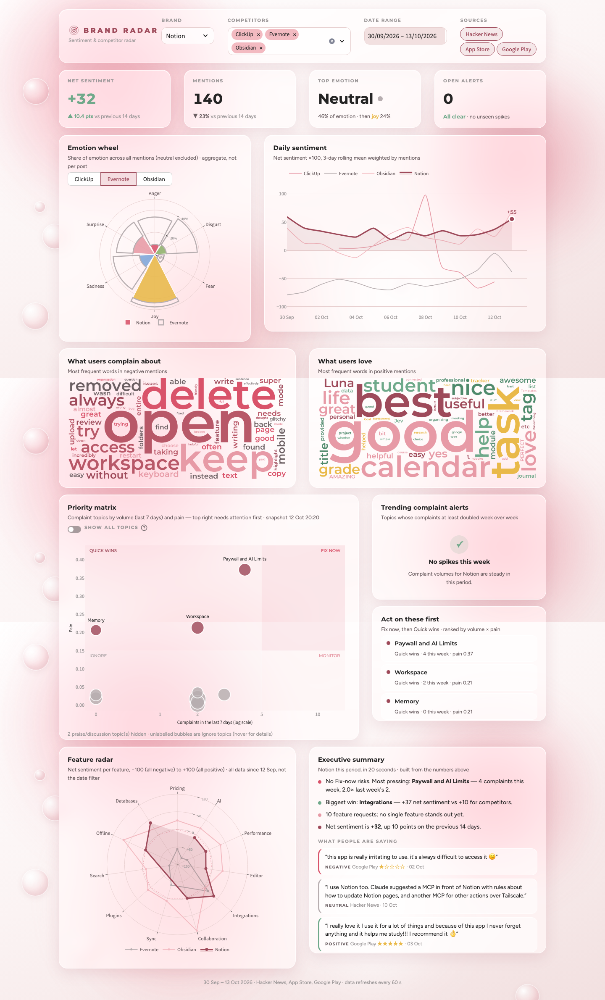

# Brand Radar

**Brand sentiment and competitor radar.** Brand Radar collects public chatter about a product and its
competitors from Hacker News, the App Store and Google Play. It analyses that chatter with local
transformer models (sentiment, emotion, category, feature) and clusters the complaints into topics.
Each topic gets a priority score, and the results appear on a live Streamlit dashboard in a
"Blush glass" design. Everything is stored in MySQL (MariaDB in XAMPP).

It tracks Notion against Obsidian, Evernote and ClickUp out of the box; brands are configured in `brands.yaml`.



## Features

- **Collector** (`collector.py`): every 6 hours it fetches new mentions, analyses them, re-clusters
  topics and recomputes priorities. NLP models are only loaded when there is something new.
- **Local NLP**: sentiment, emotion, zero-shot category and keyword-gated feature detection. It runs on
  Apple Silicon (MPS) or CPU, with no API keys or paid services.
- **Complaint topics** with BERTopic, readable labels and manual overrides (`topic_labels.yaml`).
- **Priority matrix**: complaint volume vs pain, in four quadrants (Fix now, Quick wins, Monitor, Ignore).
- **Spike alerts** when a topic's complaints at least double week over week.
- **Dashboard**:
  - KPI cards and an emotion wheel
  - sentiment trend
  - complaint and praise word clouds
  - priority matrix and feature radar vs competitors
  - alert pills
  - a 20-second executive summary built from the numbers, with representative quotes

  The KPIs, alerts and "Updated … ago" status refresh every 60 s without reloading the page.
- **Demo mode** with a separate, fictional dataset, so the dashboard can be shown without real data.

## Tech stack

| Area | Tools |
|---|---|
| Language | Python 3.11 |
| Storage | MySQL / MariaDB (XAMPP), SQLAlchemy 2, PyMySQL |
| Sources | Algolia HN Search + Firebase, iTunes RSS reviews feed, `google-play-scraper`, optional PRAW (Reddit) |
| NLP | PyTorch, Hugging Face Transformers, sentence-transformers, BERTopic (UMAP + HDBSCAN) |
| Scheduling | APScheduler |
| Dashboard | Streamlit, Plotly, `wordcloud` |
| Tests | pytest with mocked HTTP and models (no downloads), Streamlit AppTest, Playwright screenshots |

## How it works

```
 Sources                    Collector  (every 6 h, one cycle at a time)            MySQL                 Dashboard
 ───────                    ───────────────────────────────────────────            ─────                 ─────────
 Hacker News  ──┐   1 fetch      new mentions since the last success, deduped ──►  mentions, fetch_runs
 App Store    ──┼─► 2 NLP*       sentiment · emotion · category · feature    ──►  analysis              Streamlit
 Google Play  ──┤   3 topics*    BERTopic per brand, stable topic ids        ──►  topics, topic_daily ──► reads only,
 Reddit (opt) ──┤   4 priority   volume × pain, quadrants, spike alerts      ──►  topics, alerts        cached 60 s
 CSV import   ──┘                cycle record                                ──►  collector_runs
                    * runs in a short-lived child process, so the models' memory is freed after each cycle
```

The collector and the dashboard are separate processes. The dashboard only reads MySQL; it never calls an
external API or loads a model, so it stays fast and light.

## Setup

Works on macOS and Windows (Linux too). You need **Python 3.11** and **XAMPP**.

> **Note:** the Windows steps below haven't been tested on a Windows machine yet; Brand Radar was built and tested on macOS.

**1. Install XAMPP** from [apachefriends.org](https://www.apachefriends.org) and start **MySQL** in the
XAMPP Control Panel. XAMPP's MySQL client is here (its `root` user has no password by default):

| macOS | Windows |
|---|---|
| `/Applications/XAMPP/xamppfiles/bin/mysql` | `C:\xampp\mysql\bin\mysql.exe` |

**2. Get the code and create a Python environment**

```bash
git clone <this repository> BrandRadar
cd BrandRadar
```

| macOS / Linux | Windows (PowerShell) |
|---|---|
| `python3.11 -m venv venv` | `py -3.11 -m venv venv` |
| `source venv/bin/activate` | `venv\Scripts\Activate.ps1` |
| `pip install -r requirements.txt` | `pip install -r requirements.txt` |

**3. Create the database and a dedicated user.** Run these from the project folder with XAMPP's client
(replace `mysql` with the full path above if it is not on your PATH, and choose your own password).
`source` works the same in Terminal, PowerShell and cmd:

```bash
mysql -u root -e "source db/schema.sql"
mysql -u root -e "CREATE USER 'radar'@'localhost' IDENTIFIED BY 'choose-a-password'; CREATE USER 'radar'@'127.0.0.1' IDENTIFIED BY 'choose-a-password'; GRANT ALL PRIVILEGES ON brand_radar.* TO 'radar'@'localhost', 'radar'@'127.0.0.1'; GRANT ALL PRIVILEGES ON brand_radar_demo.* TO 'radar'@'localhost', 'radar'@'127.0.0.1';"
```

**4. Configuration:** copy `.env.example` to `.env` (`cp` on macOS, `copy` on Windows) and set
`DB_PASSWORD` to the password you chose. Every setting (intervals, thresholds, sources) lives in `.env`;
secrets never go in code, and `.env` is git-ignored.

**5. Brands, models, first data**

```bash
python manage_brands.py            # brands.yaml -> brands table
python -m nlp.pipeline --download  # ~2.5 GB of models into the Hugging Face cache (once)
python collector.py --once         # first fetch + analysis
python check_setup.py              # checks Python, packages, models, database, collector, demo data
```

The first analysis takes about 15 minutes on an 8 GB Apple Silicon Mac (GPU via MPS). On Windows the models
run on the CPU (or an NVIDIA GPU if PyTorch sees one), so expect it to take longer.

## Running it

| What | macOS / Linux | Windows (PowerShell) |
|---|---|---|
| Collector + dashboard together (Ctrl+C stops both) | `scripts/start.sh` | run the next two lines in two terminals |
| Collector, every `COLLECTOR_INTERVAL_HOURS` (default 6) | `python collector.py` | `python collector.py` |
| Dashboard | `streamlit run app.py` | `streamlit run app.py` |
| One collector cycle | `python collector.py --once` | `python collector.py --once` |
| Build the demo database | `python seed_demo.py` | `python seed_demo.py` |
| Dashboard on demo data | `BRAND_RADAR_DEMO=1 streamlit run app.py` | `$env:BRAND_RADAR_DEMO=1; streamlit run app.py` |
| Import a CSV (`source, author, text, date, rating`) | `python fetch.py --csv file.csv --brand Notion` | same |
| Tests | `python -m pytest -q` | same |

The dashboard opens at <http://localhost:8501>. In PowerShell, `$env:BRAND_RADAR_DEMO` stays set for that
terminal; close it (or run `Remove-Item Env:BRAND_RADAR_DEMO`) before going back to real data.

Only one collector runs at a time (a lock file plus APScheduler `max_instances=1`); a second one exits
with a message. If a stage fails, the error is logged to `collector_runs` and the later stages still run.

**Demo mode** reads a separate `brand_radar_demo` database with about 1,100 fictional mentions over 60
days, built from templates (no real people). Your real data is never touched: the seed script refuses to
write to `DB_NAME`, and the collector refuses to run in demo mode. Re-running `seed_demo.py` rebuilds it.

## Data sources and their limits

| Source | Notes |
|---|---|
| Hacker News | Algolia keyword search (stories and comments) plus Firebase. Free and reliable. Common words like "notion" need case-sensitive matching and exclude lists (`brands.yaml`). |
| App Store | The public reviews feed only returns **recent** reviews (up to ~500 per country); we read the US, India, the UK, Canada and Australia. |
| Google Play | `google-play-scraper` is unofficial and can break when Google changes its pages; failures are logged, not fatal. English, US store. |
| Reddit | **Optional.** Reddit stopped self-service API access, closes new access requests on 31 Oct 2026 and plans to end remaining access in March 2027. Skipped cleanly without credentials. |
| CSV import | Any other source (e.g. exported social posts), via `fetch.py --csv`. |

## Model quality (measured on the real data)

| Check | Result |
|---|---|
| Sentiment vs star rating, App Store | **79.2%** agree (87.9% leaving out 3★ reviews) |
| Sentiment vs star rating, Google Play | **76.5%** agree (81.3% leaving out 3★ reviews) |
| Mentions with a detected feature | 27–48% per brand (keyword gate + zero-shot confirmation) |
| Topic ids across re-runs | stable (same data -> same ids; new data joins existing topics) |
| Collector cycle, nothing new | ~1 min, no models loaded; idle collector ~55 MB |
| First full analysis, 816 mentions | ~13 min on an 8 GB M2 (MPS) |

Models: `cardiffnlp/twitter-roberta-base-sentiment-latest`, `j-hartmann/emotion-english-distilroberta-base`,
`facebook/bart-large-mnli` (zero-shot) and `sentence-transformers/all-MiniLM-L6-v2` (topics).

## Known limitations

- **English only.** Non-English reviews get analysed as English; very long non-English texts are kept out of topics.
- **One feature per mention.** A review about sync *and* pricing gets one feature; about 15% of mentions name several.
- **Keyword-based topic labels.** Some are clunky; fix them in `topic_labels.yaml` (labels written by an LLM are a planned extra).
- **Some praise lands in the complaint set** (positive reviews the model put in a complaint category). These
  topics score zero pain, so the matrix hides them by default.
- **The emotion model is weak on single reviews.** The dashboard only shows emotion in aggregate.
- **The App Store and Play history is shallow**, so trends need the collector running over time.
- **Small data.** With about 800 mentions, topics for small brands (ClickUp) can be skipped (30 complaints minimum).

## Project layout

```
app.py              Streamlit dashboard          collector.py     scheduled fetch -> NLP -> topics -> priority
fetch.py            fetch runner + CSV import    seed_demo.py     demo database
manage_brands.py    brands.yaml -> brands        check_setup.py   environment / database / model checks
config.py           settings from .env           scripts/start.sh collector + dashboard together
db/                 schema.sql, models, session
sources/            hackernews, appstore, playstore, reddit, csv_import, shared HTTP + matching
nlp/                pipeline (models, text, features), topics, priority
ui/                 styles.css (approved theme), streamlit.css, components, data, insights
tests/              pytest suite (mocked HTTP and models)
docs/               ui-decisions.md, screenshots/
```

Design decisions for the dashboard, with screenshots of each step, are in
**[docs/ui-decisions.md](docs/ui-decisions.md)**. The step-by-step build plan is in
[brand_radar_roadmap.md](brand_radar_roadmap.md).

## License

[MIT](LICENSE) © 2026 Rebecca Saxena
